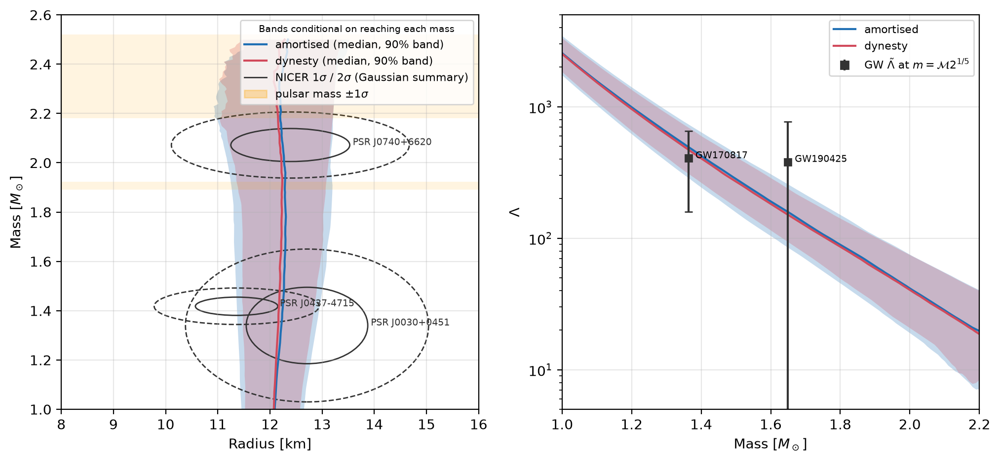
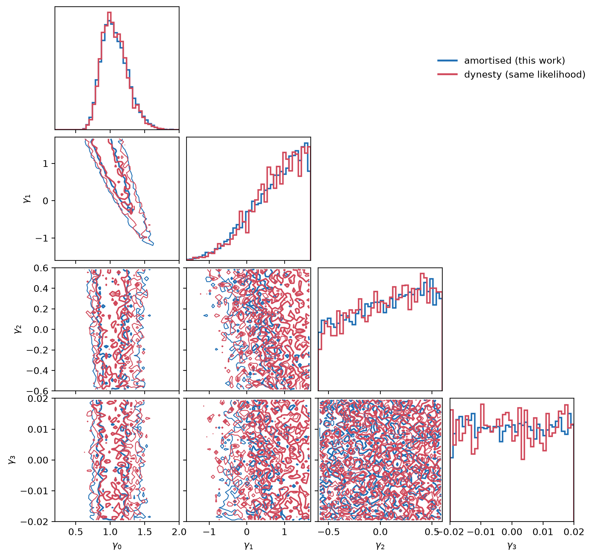
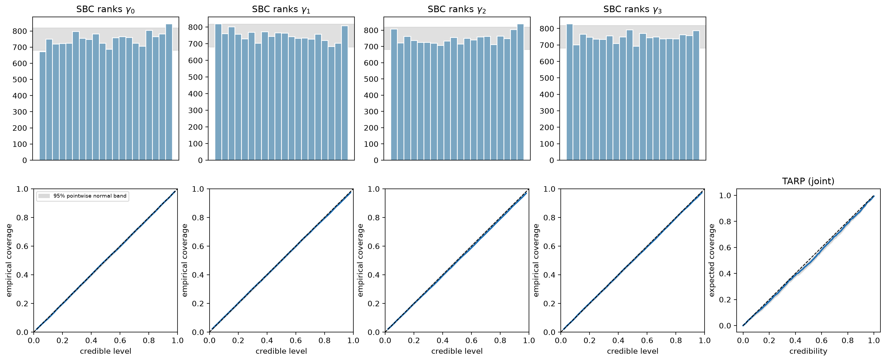

# Results — production run `run_v3`

> **Status: interim.** 9 of 17 pipeline stages are complete (snapshot taken 2026-11-19, during
> `ablate-arch`). Everything below comes from finished stages and will not change. Sections marked
> *pending* will be filled in when the run completes. Raw numbers: [`results/run_v3/`](results/run_v3/MANIFEST.md).

**Contents:** [Headline](#headline) · [Real data vs dynesty](#1-real-data-amortised-vs-dynesty) ·
[Synthetic test set](#2-held-out-synthetic-test-set-15000-catalogs) · [What the data can and cannot constrain](#3-what-the-data-can-and-cannot-constrain) ·
[Architecture ablation](#4-architecture-ablation) · [Cost](#5-cost) · [Comparison with v1](#6-comparison-with-v1) ·
[Caveats](#7-caveats-and-known-issues) · [Pending](#8-pending-stages)

---

## Headline

1. **On the real multi-messenger catalog, the amortised posterior is statistically indistinguishable from
   dynesty run with the same likelihood.** Per-parameter JS divergence is 0.0008–0.0014 bits, at the
   network's own sampling-noise floor (0.0008–0.0017 bits); a classifier two-sample test gives 0.490
   (0.5 = indistinguishable); every posterior mean agrees within 0.033 σ.
2. **Real-data EOS constraints:** R₁.₄ = 12.22 [11.46, 12.94] km, Λ₁.₄ = 418 [261, 640],
   M_TOV = 2.54 [2.21, 2.88] M☉ (medians, 90 % intervals; dynesty: 12.19 km, 413, 2.55 M☉).
3. **Calibrated on 15,000 held-out catalogs:** empirical coverage within ~1 % of nominal at the 50/68/90/95 %
   levels for every parameter; TARP max deviation 0.029.
4. **γ₂ and γ₃ are prior-dominated — and this is a property of the physics, not the network.** A near-zero-noise
   model and an independent gradient-boosting regressor on noise-free M–R–Λ curves both fail to recover γ₃
   (R² ≈ 0) and only partially recover γ₂ (R² = 0.27).
5. **Cost:** 0.84 s for 10,000 posterior draws vs 117 s for dynesty on the same precomputed likelihood grid
   (≈140× wall-clock, ≈770× per effective sample).

---

## 1. Real data: amortised vs dynesty

Catalog (deduplicated policy, 7 observations; none flagged out-of-distribution):

| object | messenger | value | σ |
|---|---|---|---|
| GW170817 | GW (Λ̃, 𝓜) | 406, 1.1869 M☉ | 247, 0.0019 |
| GW190425 | GW (Λ̃, 𝓜) | 381, 1.4357 M☉ | 389, 0.0137 |
| PSR J0030+0451 | NICER (M, R) | 1.34 M☉, 12.71 km | 0.155, 1.165 |
| PSR J0740+6620 | NICER (M, R) | 2.072 M☉, 12.39 km | 0.067, 1.14 |
| PSR J0437−4715 | NICER (M, R) | 1.418 M☉, 11.36 km | 0.037, 0.79 |
| PSR J0952−0607 | mass (optical companion) | 2.35 M☉ | 0.17 |
| PSR J1614−2230 | radio timing | 1.908 M☉ | 0.016 |

The `duplicate` sensitivity variant also adds the J0740+6620 radio mass (2.08 ± 0.07) on top of its NICER
mass; results are near-identical (below).

| metric (dedup) | γ₀ | γ₁ | γ₂ | γ₃ |
|---|---|---|---|---|
| JS, amortised vs dynesty [bits] | 0.0014 ± 0.0005 | 0.0011 ± 0.0004 | 0.0008 ± 0.0004 | 0.0008 ± 0.0003 |
| JS floor, amortised vs amortised | 0.0017 | 0.0012 | 0.0008 | 0.0008 |
| JS floor, dynesty vs dynesty | 0.0006 | 0.0003 | 0.0003 | 0.0003 |
| std ratio (amortised / dynesty) | 1.035 | 1.027 | 1.015 | 0.993 |
| Δmean / σ_dynesty | +0.022 | −0.029 | −0.033 | −0.005 |

C2ST accuracy 0.490 (dynesty-vs-dynesty floor 0.497). Largest difference in any pairwise correlation: 0.035.
JS uses matched sample sizes (n = ESS of dynesty = 1,802) and 200 subsample repeats.

| derived (median, 90 % CI) | amortised | dynesty |
|---|---|---|
| M_TOV [M☉] | 2.544 [2.214, 2.884] | 2.548 [2.239, 2.890] |
| R₁.₄ [km] | 12.22 [11.46, 12.94] | 12.19 [11.48, 12.95] |
| Λ₁.₄ | 418 [261, 640] | 413 [265, 638] |
| P(M_TOV < 2 M☉) | 0.2 % | 0.1 % |

Duplicate policy: JS 0.0007–0.0015 bits, C2ST 0.499, M_TOV 2.53, R₁.₄ 12.21 km.
Dynesty: nlive 500, rwalk, 3 independent runs, log Z = −19.01 ± 0.06 (box prior) / −18.56 (accepted prior).

 
<em>Mass–radius and mass–Λ bands from the real catalog: amortised (blue) and dynesty (red) overlap almost exactly.</em>

 
<em>Posterior over the spectral coefficients. γ₀–γ₁ are constrained (with a strong anticorrelation, ρ ≈ −0.83); γ₂, γ₃ follow the prior.</em>

## 2. Held-out synthetic test set (15,000 catalogs)

Catalogs have N ~ U{1..50} observations with a random mix of messengers and random noise levels.
"Ratio" = posterior-median MAE / MAE of the prior median (1 = no information; lower is better).

| parameter | MAE | prior MAE | ratio | contraction | ratio, linear (ridge) baseline |
|---|---|---|---|---|---|
| γ₀ | 0.109 | 0.341 | **0.320** | 0.875 | 0.598 |
| γ₁ | 0.553 | 0.765 | **0.722** | 0.401 | 0.984 |
| γ₂ | 0.295 | 0.300 | 0.983 | 0.044 | 0.998 |
| γ₃ | 0.0100 | 0.0100 | 1.001 | 0.013 | 1.000 |

Information grows with catalog size as it should (γ₀ ratio, same θ with nested subsets):
N = 1: 0.76 → 5: 0.50 → 10: 0.40 → 20: 0.31 → 50: 0.25.

**Calibration** (fraction of true values inside the central credible interval):

| level | γ₀ | γ₁ | γ₂ | γ₃ |
|---|---|---|---|---|
| 50 % | 50.2 % | 49.8 % | 49.3 % | 49.7 % |
| 68 % | 67.9 % | 67.8 % | 66.9 % | 67.4 % |
| 90 % | 90.0 % | 89.2 % | 89.1 % | 89.4 % |
| 95 % | 94.8 % | 94.3 % | 93.8 % | 94.2 % |

TARP max deviation 0.029. Derived observables on 100 test catalogs (TOV solved for posterior draws):
M_TOV MAE 0.13 M☉ (prior 0.47), R₁.₄ MAE 0.16 km (prior 0.93), Λ₁.₄ MAE 51 (prior 272); 68 % coverage 66 / 71 / 68 %.

Sanity checks: permuting or padding the observations changes the output by ≤ 2 × 10⁻⁶. Inference time is
independent of catalog size (~0.39 s for 1,000 draws with 50 RK4 steps at N = 1, 5, 10, 15 or 50).

 
<em>SBC rank histograms, coverage curves and TARP.</em>

More figures: [true vs predicted](results/run_v3/figures/true_vs_pred_main_sly4_bbfeaf259f1c9470.png) ·
[accuracy by N](results/run_v3/figures/mae_ratio_by_n_sly4_bbfeaf259f1c9470.png) ·
[training loss](results/run_v3/figures/loss_main_sly4_9bef0c6d5973af9d.png) ·
[sensitivity scans](results/run_v3/figures/sensitivity_scans_sly4_c04466dc604a640c.png)

## 3. What the data can and cannot constrain

| test | γ₀ | γ₁ | γ₂ | γ₃ |
|---|---|---|---|---|
| near-zero-noise flow model, MAE ratio | 0.032 | 0.135 | 0.664 | 0.999 |
| model-free regressor on noise-free curves, R² | 0.999 | 0.967 | 0.265 | 0.000 |
| change in R₁.₄ across the full prior range [km] | 3.24 | 0.99 | 0.23 | 0.002 |
| change in M_TOV across the full prior range [M☉] | 1.45 | 0.68 | 0.20 | 0.002 |

Fisher analysis (124 EOS): with current-precision data the median posterior/prior width is
0.37 / 0.76 / 0.99 / 1.00 (one well-constrained direction); next-generation precision gives two.
**Conclusion:** γ₃ has essentially no observable effect inside its prior box, and γ₂ only a weak one. The
network matching the prior on these parameters is the correct answer.

## 4. Architecture ablation

Identical data, decoder, budget (≤150 epochs, patience 20), three seeds each. Best validation loss (lower is better):

| encoder | seed 0 | seed 1 | seed 2 | mean |
|---|---|---|---|---|
| **Set Transformer** (used for the main model) | 1.0923 | 1.0926 | 1.0920 | **1.0923** |
| DeepSets | 1.0966 | 1.0971 | 1.0970 | 1.0969 |
| padded MLP | 1.1317 | 1.1308 | *running* | ~1.131 |

The Set Transformer's margin over DeepSets (0.0046) is ~10× the seed-to-seed spread. Test-set accuracy per
architecture: *pending (written when the stage finishes)*.

## 5. Cost

| item | measured |
|---|---|
| simulation: 157,447 attempts → 100,000 accepted EOS (63.5 %) | 14.4 h on 16 CPU threads |
| training: 3-member ensemble (7.7 M parameters each) | 5.7 h on an RTX 5070 |
| likelihood grid: 20 × 20 × 10 × 5 TOV solves | 2.0 h CPU |
| amortised posterior, real catalog, 10,000 draws | 0.84 s |
| dynesty, real catalog (35,761 likelihood calls, ESS 1,802) | 117 s |
| speed-up: wall clock / per effective sample | ≈140× / ≈770× |

Both methods use the same precomputed grid; the speed-up excludes the one-time costs above.
Break-even analysis: *pending (`economics` stage)*.

## 6. Comparison with v1

| | v1 (submitted notebook) | v2 (this run) |
|---|---|---|
| real data: JS vs dynesty, γ₀ / γ₁ | 0.51 / 0.37 (means 0.74 vs 1.00) | **0.0014 / 0.0011 bits** (Δmean 0.02 σ) |
| real data: M_TOV | 1.76 M☉ (below the training prior) | 2.54 M☉ |
| test MAE γ₀ / γ₁ | 0.099 / 0.488 | 0.109 / 0.553 |
| mean coverage error, γ₀ / γ₁ (50–95 % levels) | 0.75 % / 1.55 % | 0.13 % / 0.46 % |
| dynesty wall time / speed-up | 52 min / 12,838× | 2 min / ≈140× |

v1's slightly lower test MAE is not a like-for-like comparison: its test inputs leaked the true Λ̃ through the
GW noise level, its prior was truncated at M_max ≥ 2 M☉, and its catalogs were mostly GW events.
v1's speed-up came from a dynesty configuration that needed ~25× more likelihood calls (~900k vs 36k) for a
similar effective sample size. See [`docs/CHANGES_v2.md`](docs/CHANGES_v2.md).

## 7. Caveats and known issues

- **Ensemble member 3 stopped early** (epoch 156, best val 1.1015 vs 1.0911 for members 1–2, which ran the full
  400 epochs). It is included in the ensemble; calibration of the ensemble is shown above. Seed-to-seed spread of
  the test metrics is small (γ₀ MAE ratio 0.325 ± 0.003).
- **The upper tail of M_TOV is model-dependent.** Above the first causal crossing the EOS is continued at c_s = c
  (the stiffest causal choice). The strict-causality sensitivity is computed in the `importance` stage (*pending*).
- **Slight under-coverage at the 95 % level** (93.8–94.8 %).
- The likelihood uses Gaussian summaries of the GW and NICER posteriors, not the full posteriors.
- **Figure issue:** the 2-D contours in the corner plot are noisy for γ₂/γ₃ (KDE on nearly flat posteriors); the
  paper version should smooth them or show only the 1-D marginals for those parameters.

## 8. Pending stages

`ablate-arch` (finishing) · `ablate-messenger` · `reference-synth` (dynesty on 24 synthetic catalogs) ·
`importance` (exact importance-sampling correction, evidence, strict-causality sensitivity) · `convergence` ·
`economics` · `systematics` · `summary`. Live stage status: [`results/run_v3/MANIFEST.md`](results/run_v3/MANIFEST.md).
